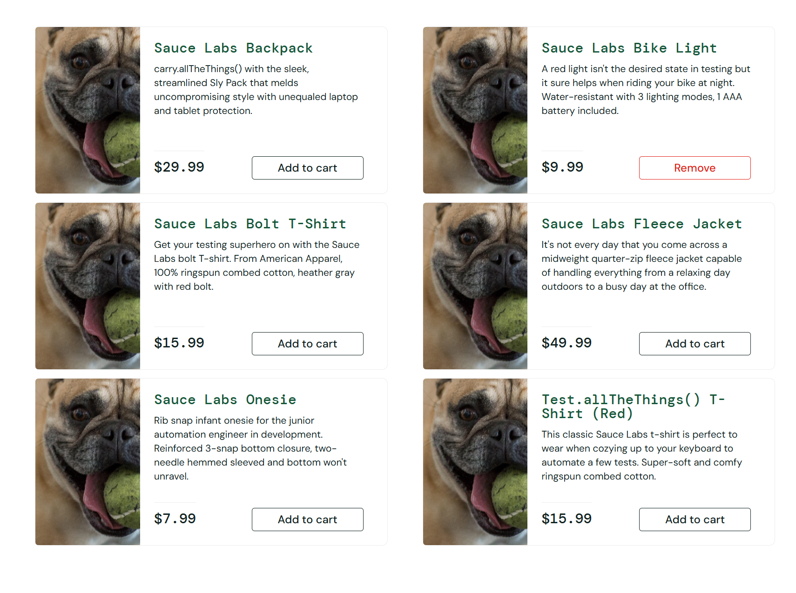

# BUG-001: у всех товаров одинаковая картинка у problem_user

| Поле         | значение                                                                   |
|--------------|----------------------------------------------------------------------------|
| Окружение    | Chrome  157.0.8103.78 ,Windows 11, [saucedemo](https://www.saucedemo.com/) |
| Пользователь | problem_user                                                               |
| Severity     | Medium                                                                     |
| Priority     | Medium                                                                     |
| Статус       | New                                                                        |
| Автотест     | ProductsTest.testProductImagesAreUniqueForProblemUser                      |

**Шаги воспроизведения**
1. Открыть https://www.saucedemo.com/
2. Ввести логин problem_user
3. Ввести пароль secret_sauce
4. Нажать Login

**Ожидаемый результат:** на странице каталога у каждого товара своя картинка.

**Фактический результат:** открывается каталог, но у всех товаров одна и та же картинка.

**Вложения:**
 